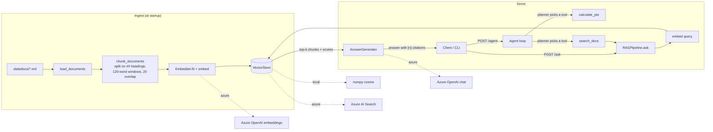

# azure-rag-agent

A small retrieval-augmented generation (RAG) service with a tool-using agent, built in Python
and aimed at Azure. It answers questions about the HR and benefits policies of **Brightwater
Analytics**, a fictional company (15 short markdown docs written for this repo), and returns
source citations with every answer.

The same code runs on two backends, picked with `RAG_BACKEND`:

| | `local` (default) | `azure` |
|---|---|---|
| Embeddings | scikit-learn TF-IDF (1–2 grams), deterministic | Azure OpenAI embeddings deployment |
| Vector index | in-memory numpy, cosine similarity | Azure AI Search (HNSW vector field) |
| Answer generation | extractive stub: picks the best-matching retrieved sentences and tags each with `[n]` | Azure OpenAI chat, grounded prompt with `[n]` citations |
| Agent planner | rule-based (regex) router | Azure OpenAI function calling (`tools=`) |
| Needs keys / network | no | yes |

> **Honest status.** Only the `local` backend was run in this build. The Azure backend code, the
> Bicep template and the deploy steps were **not executed against Azure** (no Azure subscription
> was used). The Azure adapters are covered by unit tests with fake clients, and
> `infra/main.bicep` compiles and lints cleanly with Bicep CLI 0.49.2, but neither has been
> tested end to end. Docker was not available in the build sandbox, so the image build was not
> run locally either (the CI workflow builds it). CI runs the offline backend only.

## Architecture



Deployed shape (from `infra/main.bicep`, not yet deployed): Azure Container Apps (FastAPI
container, scale 0–2) → Azure OpenAI (`gpt-4o-mini` + `text-embedding-3-small`) and Azure AI
Search, with keys passed as Container Apps secrets, logs in Log Analytics, image in Azure
Container Registry.

## Project layout

```
src/ragagent/
  config.py       Settings from env vars
  documents.py    load markdown, split into sections and overlapping word chunks
  embeddings.py   TfidfEmbedder (local) | AzureOpenAIEmbedder
  vectorstore.py  InMemoryVectorStore (local) | AzureSearchVectorStore
  llm.py          ExtractiveGenerator (local stub) | AzureChatGenerator
  rag.py          RAGPipeline: index, retrieve top-k, ask -> answer + citations
  tools.py        calculate_pto + JSON tool schemas
  agent.py        Agent loop, RuleBasedPlanner (local) | AzureToolPlanner
  factory.py      builds the chosen backend and indexes the docs
  api.py          FastAPI: /health, /ask, /agent
  evaluate.py     hit@k, MRR, citation and keyword metrics
  cli.py          `ragagent ask | agent | eval`
data/docs/        15 policy docs (fictional, written for this repo)
data/eval/        golden.jsonl (22 Qs) and golden_paraphrase.jsonl (8 harder Qs)
infra/            main.bicep + parameters
tests/            pytest suite (offline)
```

## Quickstart (local, offline)

Requires Python 3.11+.

```bash
python -m venv .venv && source .venv/bin/activate
make install            # pip install -e ".[dev]"
make test               # pytest
make eval               # writes reports/eval_results.json and reports/eval_paraphrase.json

ragagent ask "How many sick days do I get?"
ragagent agent "How much PTO do I have left with 6 years of service if I used 4 days?"

make run                # http://localhost:8000/docs
curl -s localhost:8000/ask -H 'content-type: application/json' \
  -d '{"question": "How much is the home office stipend?", "top_k": 3}'
curl -s localhost:8000/agent -H 'content-type: application/json' \
  -d '{"question": "How many vacation days with 6 years of service?"}'
```

Example output (real, from the local backend):

```
$ ragagent ask "How many sick days do I get?"
Full-time employees receive 10 paid sick days per calendar year. [1] Sick days are available on your first day of employment and do not carry over to the next year. [1]
  [1] Sick Leave Policy > Allowance (score 0.4388)
  [2] Sick Leave Policy > Extended Illness (score 0.2592)
  ...

$ ragagent agent "How many vacation days with 6 years of service?"
-> calculate_pto({"years_of_service": 6.0})
With 6 years of service you earn 25 PTO days per year. For 12 months worked that is 25 days; after 0 used, 25 remain (up to 5 can carry over). Source: PTO policy.
```

## Quickstart (Azure) — not executed in this build

```bash
pip install -e ".[azure]"
az login
make azure-deploy RG=rg-ragagent LOCATION=eastus
# = az deployment group create (infra/main.bicep), az acr build, az containerapp update
```

To run the app locally against existing Azure resources, copy `.env.example` to `.env`, set
`RAG_BACKEND=azure` and the `AZURE_*` values, then `make run`. On startup the app embeds the docs
and upserts them into the Azure AI Search index (`merge_or_upload`, so restarts are safe).
Check that `gpt-4o-mini` and `text-embedding-3-small` (and their quota) are available in your
region before deploying.

## Evaluation

`ragagent eval` runs every golden question through retrieval (top 5) and the full `/ask` path:

- **hit@k**: the expected document is among the top-k retrieved chunks.
- **MRR**: mean reciprocal rank of the expected document.
- **answer_has_citation**: the answer contains at least one `[n]` that maps to a returned citation.
- **answer_cites_expected_doc**: one of those cited `[n]` points to the expected document.
- **answer_contains_keywords**: the answer contains every expected keyword (e.g. `16 weeks`).

Results from running offline with the local backend (`reports/eval_results.json`,
`reports/eval_paraphrase.json`):

| Metric | golden.jsonl (22 Qs) | golden_paraphrase.jsonl (8 Qs) |
|---|---|---|
| hit@1 | 1.000 | 0.375 |
| hit@3 | 1.000 | 0.750 |
| hit@5 | 1.000 | 0.750 |
| MRR | 1.000 | 0.521 |
| answer_has_citation | 1.000 | 0.750 |
| answer_cites_expected_doc | 1.000 | 0.625 |
| answer_contains_keywords | 0.955 (21/22) | 0.375 (3/8) |

How to read these:

- The main set is **easy for keyword retrieval**: I wrote both the docs and the questions, so the
  questions share words with the answers. Perfect retrieval here mostly shows the plumbing works,
  not that TF-IDF is a good retriever.
- The paraphrase set uses different wording ("My grandmother passed away…", "When do raises kick
  in?"), and TF-IDF falls apart: no synonyms, no stemming ("vendor" ≠ "vendors"). This gap is
  exactly what neural embeddings (the Azure backend) are meant to close, but **no Azure numbers are
  reported because the Azure backend was not run**.
- The one main-set miss: for "What is the 401(k) employer match?" the extractive stub picked the
  vesting sentence instead of the 4% match sentence, because it ranks sentences by word overlap.
- CI fails if main-set hit@5 drops below 0.9.

## Tests

```bash
pytest -q   # 34 passed (local run, offline, no Azure SDKs installed)
```

Covers chunking, embeddings and the vector store, retrieval and citations, out-of-domain
refusal, PTO maths (tiers, proration, carryover cap, bad input), agent routing, tool-error
handling and the step limit, the FastAPI endpoints and input validation, config and backend
selection, the Azure adapters against fake clients, and an eval regression floor.

## CI

`.github/workflows/ci.yml`: ruff lint and format check → pytest → both evals (results uploaded as
an artifact) → Docker image build. Everything runs with `RAG_BACKEND=local`, so no secrets are
needed. The workflow has not run on GitHub yet because the repo has not been pushed.

## Limitations and next steps

- The local "LLM" only extracts sentences. It does not paraphrase, combine facts or reason.
- The local agent planner is regex-based, so it only handles phrasing it was written for. The
  Azure planner uses real function calling but was not run.
- Agent loop handles one tool call per turn and keeps no conversation memory.
- The index is rebuilt in memory on every start (fine for 15 docs, not for large corpora).
- The Azure path uses API keys stored as Container Apps secrets and an ACR admin user, which keeps
  the demo simple. Production should use managed identity (Azure OpenAI and AI Search RBAC,
  `AcrPull`) and Key Vault.
- No auth or rate limiting on the API, no streaming, no LLM-as-judge answer evaluation.

## License

MIT © 2026 Kedarnath Pandiri. The policy documents are fictional and released under the same
license.
